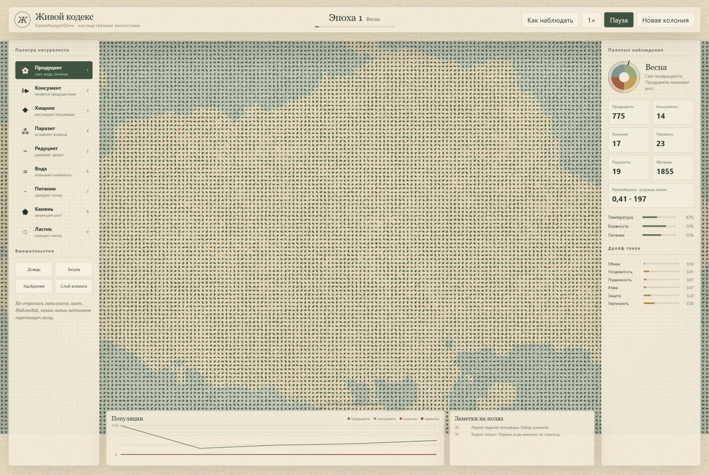

<p align="center">
  
  
  
  
</p>

<h1 align="center">GameHungerGEvo · Живой кодекс</h1>
<p align="center">Эволюция, записанная на бумаге: сезоны, наследственность, хищники, паразиты и мутации.</p>

---

**Живой кодекс** — интерактивная экосистема на странице натуралиста. Клетки живут по правилам Конвея, но продуценты, консументы, хищники, паразиты и редуценты образуют полноценную пищевую сеть. Организмы наследуют шесть признаков, мутируют при размножении и постепенно адаптируются к смене сезонов.

- **Настоящая наследственность** — геном из шести признаков, мутации и родовые линии.
- **Циклы природы** — четыре сезона, температура, влага, свет и питательные вещества.
- **Трофическая сеть** — продуценты, консументы, хищники, паразиты и редуценты.
- **Бумажная графика** — WebGL2 рисует акварель, тушь и органические клетки; есть Canvas 2D fallback.
- **Адаптивность** — 4К, три монитора, поворот поля на вертикальном экране, mobile landscape.
- **Вмешательство исследователя** — кисти видов, климат, засуха, дождь и наблюдение за дрейфом генов.

## Быстрый старт

Открой `index.html` двойным щелчком. Для проверки без браузера:

```bash
node scripts/check-evo.cjs
```

## Скриншот

<p align="center"></p>

## Документация

- [`docs/CONTEXT.md`](docs/CONTEXT.md) — состояние проекта и глоссарий.
- [`docs/DECISIONS.md`](docs/DECISIONS.md) — архитектурные решения.

## Статус

**v1.0** — Полная экосистема с наследственностью, сезонами и трофической сетью. Проверены прямой `file://`-запуск, WebGL2/Canvas fallback, 4К/portrait/mobile layout и 60 fps на активной вкладке.

## Лицензия

[MIT](LICENSE) © Alexander Kuzikov
